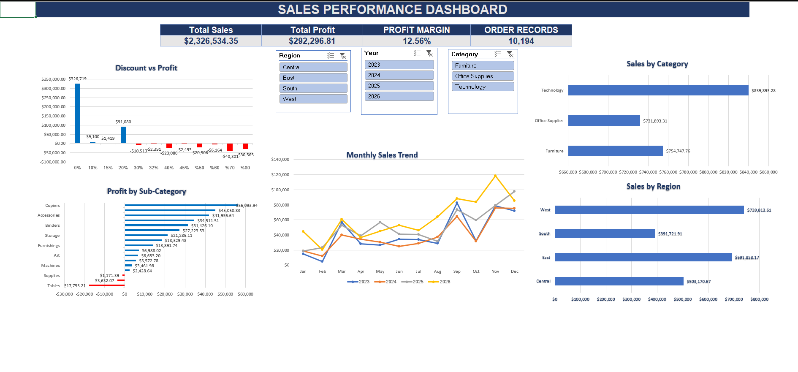

# Sales Performance Analysis | Excel Dashboard

## Project Overview
An interactive Sales Performance Dashboard developed using Microsoft Excel to analyze sales, profitability, regional performance, product categories, and discount patterns.

The project transforms raw sales data into meaningful business insights through data preparation, PivotTables, KPIs, charts, and interactive slicers.

## Tools & Technologies
- Microsoft Excel
- Excel Tables
- PivotTables
- PivotCharts
- Excel Formulas
- Slicers
- Data Cleaning & Analysis

## Project Structure
The workbook contains four worksheets:

- **Data:** Raw sales data and calculated columns.
- **Analysis:** PivotTables used to analyze business performance.
- **Dashboard:** Interactive dashboard with KPI Cards, charts, and slicers.
- **Insights:** Key business findings and recommendations.

## Key Performance Indicators
- Total Sales: $2,326,534.35
- Total Profit: $292,296.81
- Profit Margin: Approximately 12.57%
- Order Records: 10,194

## Key Analyses
- Sales and Profit by Category
- Monthly Sales Trends (2023–2026)
- Regional Sales and Profitability
- Sub-Category Performance
- Discount Analysis

## Key Business Insights
- Technology recorded the highest sales among the three product categories.
- The West region achieved the highest sales and profit.
- Furniture had a relatively low profit margin of 2.61%.
- Copiers generated the highest sub-category profit.
- Tables recorded the largest sub-category loss.
- Discount levels of 30% and above recorded negative aggregate profit.

## Interactive Features
The dashboard includes interactive slicers for:
- Year
- Region
- Category

These filters allow users to explore performance across different business dimensions.

## Business Recommendations
- Review the profitability of Furniture products.
- Analyze the West region's performance to identify practices that could benefit other regions.
- Review high-discount transactions and their profitability.
- Investigate loss-making sub-categories, particularly Tables and Bookcases.

## Skills Demonstrated
- Data Cleaning and Preparation
- Exploratory Data Analysis
- Business Performance Analysis
- KPI Development
- Data Visualization
- Dashboard Development
- Business Insights and Recommendations
